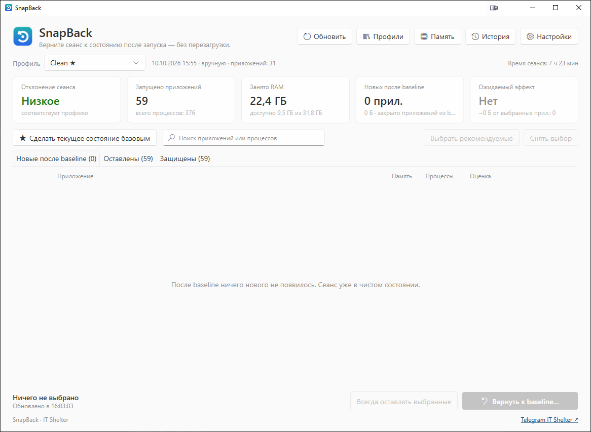

# SnapBack

[English](README.md) · **Русский** · [简体中文](README.zh-CN.md)

**Верните сеанс Windows к состоянию «сразу после запуска» — без перезагрузки.**

[Скачать для Windows](../../releases) · [Telegram IT Shelter](https://t.me/+ihTcvubt-_BhZTQ6) · [IT-Shelter-Labs](https://github.com/IT-Shelter-Labs)



*Скриншот настоящего Windows-приложения. Интерфейс доступен на русском, английском и китайском.*

Сразу после входа в систему Windows находится в относительно чистом состоянии: системные процессы,
автозагрузка — и всё. Через несколько часов работы добавляются браузеры, Discord, Telegram, IDE,
процессы Python и Node.js, WSL, Docker, лаунчеры и фоновые помощники. SnapBack запоминает нужное вам
состояние (**baseline** или несколько именованных *профилей*, например *Чистый*, *Работа* или
*Игры*), показывает, насколько сеанс от него отклонился и что на самом деле занимает память, и
возвращает сеанс **вежливо** — закрывает лишние приложения так же, как если бы вы нажали ✕:
приложения успевают сохранить данные или спросить вас.

SnapBack — **не** «очиститель памяти» и не «ускоритель». Его главная задача — с вашего согласия
закрыть приложения, запущенные после baseline. Для редких случаев, когда нужно сбросить файловый кэш
Windows, есть отдельная необязательная функция *глубокой очистки памяти*.

---

## Как это работает

1. **Baseline.** Нажмите «Сделать текущее состояние базовым» (или позвольте SnapBack сделать это
   автоматически через несколько минут после входа, когда программы автозагрузки закончат запуск).
   Baseline хранит **приложения**, а не просто PID.
2. **Сравнение.** SnapBack группирует процессы в приложения (30 процессов `chrome.exe` — одно
   приложение; VS Code со всеми помощниками — одно приложение) и сравнивает их с baseline. Приложение
   из baseline остаётся в нём и после перезапуска или обновления; новые дочерние процессы такого
   приложения не являются причиной его закрывать.
3. **Просмотр.** Вы видите, что появилось после baseline: иконка, память, число процессов, оценка
   риска. Списки можно сортировать по любому столбцу и фильтровать поиском:

   | Приложение            | Память | Оценка                     |
   |-----------------------|-------:|----------------------------|
   | Discord               | 650 МБ | Безопасно                  |
   | Visual Studio Code    | 1,4 ГБ | Возможны несохранённые данные |
   | python.exe — train.py | 740 МБ | Требует проверки           |
   | Google Chrome         | 3,2 ГБ | Был в baseline             |

   Заранее отмечены только приложения с оценкой **«Безопасно»**. Любое можно снять или добавить в
   список «Всегда оставлять».
4. **Предварительный просмотр.** До любого действия показывается каждый шаг. **Пробный прогон**
   проверяет все шаги на живой системе, ничего не меняя.
5. **Вежливое закрытие.** Выбранные приложения получают обычный запрос на закрытие и время на
   сохранение или на то, чтобы спросить вас. Ничего не завершается принудительно.
6. **Ваше решение.** Приложения, которые не закрылись (например, спрашивают «Сохранить
   изменения?»), показываются отдельно. Можно переключиться на них и нажать «Проверить снова» — или
   отдельно и явно завершить принудительно конкретные приложения.
7. **До → После.** В результате показываются приложения, процессы, используемая ОЗУ, доступная
   память и кэш до и после, а также память, освобождённая закрытием приложений.

## Панель: отклонение сеанса и ожидаемый эффект

В верхней части окна — то, что нужно для решения, а не полноценный системный монитор:

```text
Профиль: Чистый                    Время сеанса: 10 ч 21 мин
Отклонение   Запущено     Занято RAM   Новых после   Ожидаемый
сеанса       приложений                baseline      эффект
Высокое      31           18,4 ГБ      12 прил.      Высокий
+12 прил. ·  всего        доступно     7,1 ГБ        ~7,1 ГБ от
+87 проц. ·  процессов:   13,2 ГБ                    выбранных
+7,1 ГБ      286                                     прил.: 9
```

- **Отклонение сеанса** (*Низкое / Среднее / Высокое*) — насколько сеанс ушёл от профиля. Оценка от
  0 до 100 складывается из четырёх ограниченных частей: новые приложения (по 4 балла, не больше 40),
  занятая ими память относительно установленной ОЗУ (2 балла за каждый процент, не больше 40),
  лишние процессы (1 балл за каждые 8, не больше 10) и возраст baseline (до 10 баллов после суток и
  только если есть что-то новое). Меньше 20 — низкое, меньше 50 — среднее, выше — высокое. Кэш
  никогда не учитывается.
- **Ожидаемый эффект** — оценка, сделанная *до* того, как что-либо закрыто: личная память
  приложений, которые будут закрыты, в сравнении с установленной памятью (10 % и больше — высокий,
  4 % и больше — или восемь приложений и больше — средний). Всплывающая подсказка и предварительный
  просмотр раскладывают «Занято RAM» на новые приложения, приложения профиля и систему и прочее, а
  кэш показывают отдельно, потому что он уже доступен:

  ```text
  Занято RAM: 23,4 ГБ
    Новые приложения:    7,8 ГБ
    Приложения профиля:  4,9 ГБ
    Система и прочее:   10,7 ГБ
  Кэш / standby: 7,0 ГБ (уже доступен, не занят)
  Оценка освобождения: ~7,8 ГБ      Ожидаемый эффект: Высокий
  ```

  Если большую часть памяти занимают не приложения, добавленные после baseline, SnapBack так и
  говорит — и никогда не обещает точное число: общая память, приложения, которые отказываются
  закрываться, и кэш Windows делают реальный результат другим.

## Профили

Вместо одного baseline можно хранить несколько профилей — например, *Чистый*, *Работа*, *Игры*,
*Стриминг* — у каждого свой список приложений, которые должны оставаться запущенными. В окне
**«Профили»** можно создать профиль из текущего состояния, переименовать его, обновить из текущего
состояния, удалить или добавить отдельные приложения, удалить профиль и выбрать основной. Выбор
профиля в главном окне определяет, с каким профилем сравнивается сеанс; сам выбор ничего не
закрывает.

*Подготовиться к играм* — это просто: выберите *Игры* (Steam, Discord, утилиты видеокарты, лаунчер) и
нажмите *Вернуть к «Игры»* — обычный предварительный просмотр предложит закрыть IDE, лишние браузеры
и рабочие приложения. Профиль может также предлагать остановить WSL и Docker (см. ниже); это
подтверждается каждый раз. Встроенных жёстко заданных профилей нет: предлагаемые названия — лишь
подсказки, которые можно изменить.

Единственный `baseline.json` из прежних версий автоматически становится профилем *Чистый*.

## Правила: всегда оставлять, всегда закрывать, спрашивать каждый раз

Щёлкните приложение в списке правой кнопкой (или откройте *Настройки → Правила*):

- **Всегда оставлять** — никогда не предлагается к закрытию ни в одном профиле.
- **Всегда закрывать** — отмечается заранее при каждом возврате к профилю, даже если было запущено в
  момент записи профиля (приложения, требующие ручной проверки, — скрипты, консоли, процессы без окон —
  всё равно заранее не отмечаются).
- **Спрашивать каждый раз** — предлагается, но никогда не отмечается заранее.

Правила определяют только то, что предлагается и отмечается. Они никогда не меняют защиту, не
пропускают предварительный просмотр, вежливое закрытие и проверки безопасности на живой системе, а
«Всегда закрывать» никогда ничего не завершает принудительно.

## Память во времени

Пока SnapBack работает, он записывает выделенную память каждого запущенного приложения не чаще раза
в 10 минут (одна точка на каждый анализ, который он и так выполняет; не больше 96 точек на приложение
и 64 приложений, только в памяти). Окно **«Память»** показывает приложения, память которых
продолжает расти:

```text
Discord              Необычный рост памяти
420 МБ → 1,4 ГБ за 9 ч
10:00 420 МБ · 13:00 610 МБ · 16:00 940 МБ · 19:00 1,4 ГБ
```

*Необычный рост памяти* означает: минимум за два часа — не меньше +500 МБ и ×1,5, с ростом на
большинстве шагов. SnapBack никогда не называет это утечкой — кэш и рост нагрузки (вкладки,
документы) тоже увеличивают память; перезапуск приложения её освобождает.

## WSL и Docker

WSL (`vmmemWSL`/`vmmem`, `wslhost`, `wslservice`) и Docker Desktop (`Docker Desktop.exe`,
`com.docker.*`, `vpnkit`) распознаются и **никогда не закрываются как обычные приложения** — они
защищены. Когда они запущены, панель показывает их вместе с занятой памятью и собственным действием
остановки:

- **Остановить WSL…** выполняет `wsl --shutdown`.
- **Остановить Docker…** выполняет `docker desktop stop` (Docker Desktop 4.37 или новее; для более
  старых версий сообщается, что это не поддерживается, — закройте Docker Desktop через его значок в
  трее).

Перед остановкой SnapBack показывает, что будет остановлено, — работающие дистрибутивы
(`wsl --list --running`) или работающие контейнеры (`docker ps`) — и предупреждает, что службы Linux,
контейнеры и несохранённая работа внутри них тоже остановятся. Непосредственно перед выполнением
команды он проверяет ещё раз; если за это время запустилось что-то новое, ничего не останавливается
и вас спрашивают снова. SnapBack никогда не завершает процессы `vmmem` или Docker и выполняет эти
команды только для чтения лишь тогда, когда среда уже запущена, поэтому сам никогда не запускает WSL
или Docker.

## Память: что действительно занято, а что — просто кэш

Windows хранит недавно использованные данные в памяти как **кэш standby**. Этот кэш считается
**доступной** памятью: Windows мгновенно отдаёт его любому приложению, которому нужна память. Большое
значение «Кэш» — это нормально, а «свободная» память — просто неиспользуемая.

Поэтому SnapBack честно показывает обе стороны:

- **Используется ОЗУ** и **Доступно** — что реально занимают приложения и система и что доступно.
- **Кэш (standby + modified)** — переиспользуемый кэш.
- **Освобождено закрытием приложений** — личная память завершившихся приложений. Это и есть реальный
  эффект «Вернуть к baseline».

Окно **«Память»** простыми словами объясняет текущую ситуацию. Если доступной памяти достаточно, оно
так и говорит и не предлагает очистку; если памяти мало — объясняет, что помогает закрытие приложений.

### Глубокая очистка памяти (необязательно, для опытных)

Отдельное действие в окне «Память» (доступно и из результата «Вернуть к baseline»). Оно **никогда не
запускается автоматически** и **никогда не является частью «Вернуть к baseline»**.

- **Механизм:** `NtSetSystemInformation(SystemMemoryListInformation, …)` с командами очистки списка
  standby — тот же механизм, что использует Sysinternals RAMMap для *Empty Standby List*. Два режима:
  *весь кэш standby* (`MemoryPurgeStandbyList`) или *только низкоприоритетный кэш*
  (`MemoryPurgeLowPriorityStandbyList`).
- **Очищает:** страницы standby (кэшированные данные, которые сейчас не используются). Они сразу
  становятся свободной памятью.
- **Никогда не трогает:** память, которую используют приложения (никакого урезания working set и
  `EmptyWorkingSet`), список modified (данные, ожидающие записи на диск), выделенную память (commit),
  системные настройки, службы и файл подкачки. Отправить можно только две команды очистки; остальные
  отклоняются в коде и проверяются тестами.
- **Эффект:** доступная память почти не меняется — кэш и так считался доступным. Windows снова
  наполнит кэш по мере работы, поэтому какое-то время приложения и файлы могут открываться чуть
  медленнее. SnapBack показывает сброшенный кэш отдельно от памяти, освобождённой закрытием
  приложений; эти величины никогда не складываются.
- **Права:** для очистки нужны права администратора и привилегия `SeProfileSingleProcessPrivilege`.
  Сам SnapBack продолжает работать как обычный пользователь: только для этой операции Windows
  показывает запрос UAC и запускает кратковременный помощник
  (`SnapBack.exe --deep-cleanup standby|low-priority`). Помощник принимает только эти два
  фиксированных значения, не читает и не пишет файлы и сообщает результат только кодом выхода. Если
  отклонить запрос, ничего не изменится.

## Безопасность прежде всего

SnapBack исходит из того, что **закрыть не тот процесс намного хуже, чем закрыть слишком мало**.
Подробно — в [docs/SAFETY.md](docs/SAFETY.md).

- **Только ваши приложения в вашем сеансе.** Процессы других пользователей и сеансов, службы,
  процессы с правами администратора, критические и защищённые процессы, компоненты Windows
  **защищены**. Нет настройки, которая сняла бы защиту.
- **Fail closed.** Если какой-либо важный для безопасности факт о процессе проверить не удалось
  (владелец, путь, повышение прав, флаг критичности, уровень защиты), процесс считается защищённым.
- **PID никогда не используется в одиночку.** Процесс идентифицируется парой *PID + время создания*.
  Идентичность, исполняемый файл, сеанс, владелец и защита перепроверяются **на том самом
  дескрипторе, через который выполняется действие**, поэтому переиспользованный PID не будет задет.
- **Три независимых уровня защиты:** классификация, safety guard (повторная проверка живого процесса
  прямо перед действием) и проверка дескриптора на уровне Windows. Ошибка в интерфейсе не может
  привести к закрытию защищённого процесса.
- **Вежливо по умолчанию, принудительно — только по запросу.** Оконные приложения получают обычный
  запрос на закрытие (`WM_CLOSE`), приложения в трее — запрос через Windows Restart Manager без флага
  принуждения, консольные программы — Ctrl+C, и только если их консоль не разделена с посторонними
  программами. Принудительное завершение требует отдельного подтверждения, которое действует только
  для конкретных экземпляров процессов и истекает через 5 минут.
- **Профили и правила не могут ослабить ничего из этого.** «Всегда закрывать» только отмечает
  заранее; защищённые процессы остаются защищёнными; WSL и Docker останавливаются только их
  собственными командами и после предупреждения.
- **Без прав администратора для обычной работы, без драйвера, без служб.** Единственный путь с
  повышенными правами — описанный выше помощник необязательной глубокой очистки.

## Требования

- Windows 10 (1809+) или Windows 11, x64 или ARM64.
- Релизные сборки самодостаточны — отдельная установка .NET не нужна.

## Установка

Скачайте `SnapBack-<версия>-win-x64.zip` (или `win-arm64`) со страницы [Releases](../../releases),
распакуйте в любую папку (например, `%LOCALAPPDATA%\Programs\SnapBack`) и запустите `SnapBack.exe`.
Целостность можно проверить по `SHA256SUMS.txt`.

Исполняемые файлы пока не подписаны цифровой подписью, поэтому при первом запуске Windows SmartScreen
может показать «Система Windows защитила ваш компьютер»: нажмите «Подробнее → Выполнить в любом случае»
(при желании сначала сверьте SHA-256).

Установщика нет, ничего не регистрируется в системе. Для удаления отключите «Запускать SnapBack
вместе с Windows» в настройках (если включали), выйдите из SnapBack через значок в трее, затем
удалите папку и `%LOCALAPPDATA%\SnapBack`.

## Использование

- Выбор **профиля** и кнопка **«Профили»** — с каким состоянием сравнивать; создание,
  переименование, обновление, редактирование и удаление профилей, выбор основного.
- **Сделать текущее состояние базовым** — то, что запущено сейчас, становится выбранным профилем.
- **Новые после baseline / Оставлены / Защищены** — три списка. Щелчок по заголовку столбца
  («Приложение», «Память», «Процессы», «Оценка») сортирует список, повторный — меняет порядок. Память
  сортируется по реальному числу байт. Поле поиска (Ctrl+F) фильтрует по имени приложения,
  исполняемого файла или скрипта. Выбор сохраняется при сортировке, поиске и обновлении. Правила
  задаются щелчком правой кнопкой по приложению.
- **Вернуть к baseline…** (при нескольких профилях — *Вернуть к «Игры»…*) — открывает
  предварительный просмотр с ожидаемым эффектом; без подтверждения там ничего не происходит.
- **Всегда оставлять выбранные** — добавляет для выбранных приложений правило «Всегда оставлять».
- **Память** — подробности о памяти, рекомендации, память во времени и необязательная глубокая
  очистка.
- **История** — по каждой операции: профиль, дата и время, приложения / процессы / занятая RAM /
  доступная память до → после, память, освобождённая приложениями, закрытые приложения,
  принудительные завершения, использовалась ли глубокая очистка памяти (и сколько кэша она сбросила —
  отдельно), остановленные среды и длительность. История хранит последние 50 операций (можно
  увеличить до 500).
- **Настройки** — язык, автозапуск и трей, уведомления, время ожидания закрытия, предвыбор
  приложений «с предупреждением», правила, папка данных.

### Область уведомлений (трей)

Пока SnapBack работает, его значок находится в области уведомлений. Всплывающая подсказка
показывает состояние (*SnapBack · Чистый — лишних приложений: 7 · ~5,4 ГБ можно освободить*), а меню
содержит *Открыть SnapBack*, *Вернуть к baseline…* (открывает окно и обычный предварительный
просмотр — прямо из меню ничего не закрывается), *Выбрать профиль*, *Обновить «профиль» из текущего
состояния…*, *Обновить* и *Выход*.

Закрытие окна сворачивает его в трей (в первый раз это поясняет уведомление); в *Настройки → При
закрытии окна* можно сделать так, чтобы кнопка закрытия завершала программу. Повторный запуск
`SnapBack.exe` показывает уже работающий экземпляр; `SnapBack.exe --quit` просит его завершиться.

В фоне SnapBack почти ничего не делает: один анализ раз в 15 минут, пока окно скрыто, в потоке с
фоновым приоритетом и с включённым режимом эффективности Windows (EcoQoS). Между анализами никакого
опроса; ожидание не тратит процессорное время.

### Уведомления

Необязательны (*Настройки → Показывать уведомления*) и намеренно редки: когда отклонение высокое
**и** возврат к профилю освободил бы не меньше 1 ГБ памяти приложений, а память при этом
заканчивается (или ожидаемый эффект высокий) — не чаще раза в 6 часов и повторно только после того,
как отклонение снизилось; а также один раз на экземпляр приложения при необычном росте памяти. Не
больше трёх в день, никогда — пока окно открыто, никогда — из-за кэша. Режим «Не беспокоить» Windows
соблюдается.

### Запуск вместе с Windows

*Настройки → Автозапуск*:

- **Запускать SnapBack вместе с Windows** — добавляет запись `Run` текущего пользователя
  (`"…\SnapBack.exe" --autostart`), которая видна в *Параметры Windows → Приложения → Автозагрузка*.
  Без прав администратора, без запланированной задачи, без службы. Запись следует настройке и
  исправляется, если вы переместили SnapBack.
- **Запускать свёрнутым в трей** — при входе окно не открывается.
- **Автоматически создавать baseline после запуска** — обновляет выбранный профиль (основной, если не
  выбран другой) один раз за вход, не раньше чем через 2 минуты, когда 45 секунд не запускаются новые
  приложения **и** процессор больше не занят (всё настраивается, максимум — 10 минут). Ничего не
  закрывает.

### Язык

Встроены English, Русский и 简体中文. В «Настройки → Язык» можно выбрать «Как в системе» (следует
языку интерфейса Windows; неподдерживаемые языки заменяются английским) или конкретный язык.
Изменение применяется сразу, без перезапуска.

## Командная строка

`snapback-cli.exe` использует то же ядро и те же проверки безопасности, что и окно. Вывод — на
английском.

```text
snapback-cli status [--json]              профиль, отклонение, память, ожидаемый эффект, WSL/Docker
snapback-cli baseline create [--force]    сделать текущее состояние выбранным профилем
snapback-cli baseline show [--all] [--json]
snapback-cli list [--all] [--json]        приложения, запущенные после baseline
snapback-cli preview [выбор] [--json]     пробный прогон: все шаги и вердикт проверок
snapback-cli restore [выбор] [--yes]      попросить выбранные приложения закрыться (без принуждения)
snapback-cli history [--json]
snapback-cli memory [--json]              занятая память и переиспользуемый кэш, с рекомендацией
snapback-cli profiles [--json]
snapback-cli profile create|update|rename|delete|default|use <имя> [<новое имя>]
snapback-cli rules [--json]
snapback-cli rule keep|close|ask|clear <приложение>
snapback-cli env [--json]                 состояние WSL / Docker (только чтение)

выбор: --app <имя> (можно несколько) | --include-caution | --include-review
--profile <имя>: status/list/preview/restore относительно этого профиля (не выбирая его)
```

CLI намеренно **не умеет** завершать что-либо принудительно, не выполняет глубокую очистку памяти и
не останавливает WSL или Docker (окно сначала показывает предупреждение).

## Ограничения

- Классификация частично основана на именах известных программ; неизвестные приложения оцениваются
  по наличию окон (оконное приложение всегда может спросить вас; приложение без окна требует проверки).
- Приложения с правами администратора не закрываются (намеренно). Если контроль учётных записей
  отключён, все приложения работают с повышенными правами, и SnapBack показывает их как защищённые.
- Приложение, которое игнорирует и запрос на закрытие, и Restart Manager, можно закрыть только
  вручную или явным принудительным завершением.
- Глубокая очистка не увеличивает *доступную* память — она лишь опустошает кэш, который Windows и так
  переиспользовала бы. Чаще всего она не нужна.
- Размеры списков памяти берутся из счётчиков производительности Windows; если они отключены,
  SnapBack использует размер системного кэша и показывает неизвестные значения как «—».
- Отклонение, ожидаемый эффект и рост памяти — эвристики. Личная память приложений не складывается
  точно в «Занято RAM» (общая память, драйверы, ядро), поэтому остаток показывается как *система и
  прочее*.
- История памяти существует только пока работает SnapBack (она не сохраняется), поэтому рост
  становится виден после нескольких часов работы в фоне.
- Для остановки Docker нужен Docker Desktop 4.37 или новее (`docker desktop stop`). Docker Engine,
  установленный внутри дистрибутива WSL, останавливается вместе с WSL. WSL определяется по `vmmemWSL`
  (Windows 11) или `vmmem` вместе со вспомогательными процессами WSL.
- Значку в трее нужна панель задач Проводника; без неё SnapBack вместо этого показывает своё окно.

## Сборка из исходников

Нужен [.NET SDK 10](https://dotnet.microsoft.com/download) (см. `global.json`).

```powershell
git clone https://github.com/IT-Shelter-Labs/SnapBack-Rebootless.git
cd SnapBack-Rebootless
dotnet build SnapBack.sln -c Release
dotnet test SnapBack.sln -c Release
dotnet run --project src/SnapBack.App

# Самодостаточная сборка в один файл
dotnet publish src/SnapBack.App -c Release -r win-x64 --self-contained -p:PublishSingleFile=true -p:IncludeNativeLibrariesForSelfExtract=true -o publish
dotnet publish src/SnapBack.Cli -c Release -r win-x64 --self-contained -p:PublishSingleFile=true -o publish
```

Платформонезависимое ядро и его тесты (300+) собираются и запускаются также на Linux и macOS
(`dotnet test tests/SnapBack.Core.Tests`). CI собирает проект на Windows, запускает модульные и
интеграционные тесты, публикует приложение, проверяет настоящий интерфейс через UI Automation на всех
трёх языках, а также запуск в трей, запись автозапуска, автоматический baseline, нагрузку на
процессор и память в простое, активацию уже работающего экземпляра, сворачивание в трей при
закрытии и `--quit`.

Переводы находятся в `src/SnapBack.Core/Localization/Strings*.resx` (тексты ядра) и
`src/SnapBack.App/Localization/Strings*.resx` (тексты интерфейса). Тесты проверяют, что в каждом
языке есть каждая строка с теми же подстановками.

## Структура проекта

```text
src/
  SnapBack.Core/      платформонезависимое ядро: модель, классификация, группировка, baseline,
                      профили, правила, планирование, safety guard, закрытие, анализ памяти,
                      отклонение / эффект / рост памяти, политика уведомлений, протокол WSL/Docker,
                      протокол глубокой очистки, сортировка/поиск, локализация, хранение, логирование
  SnapBack.Windows/   реализация на Win32: снимок процессов, окна, службы, Restart Manager,
                      Ctrl+C для консолей, действия через проверенный дескриптор, счётчики памяти,
                      очистка standby, значок в области уведомлений, запись автозапуска, запуск
                      команд, фоновые режимы
  SnapBack.App/       приложение на WPF (тема Fluent, светлая/тёмная, три языка)
  SnapBack.Cli/       командная строка
tests/                модульные тесты, интеграционные тесты Windows, тестовое приложение
ci/                   проверки через UI Automation для CI (интерфейс, трей/автозапуск)
docs/                 ARCHITECTURE.md, SAFETY.md
```

## Данные и приватность

Всё хранится в `%LOCALAPPDATA%\SnapBack` (можно переопределить переменной `SNAPBACK_DATA_DIR`):
`settings.json`, `profiles.json`, `history.json` и ежедневные логи в `logs\` (хранятся 14 дней).
История памяти хранится только в оперативной памяти. Заголовки окон и командные строки показываются
только в интерфейсе и никогда не записываются на диск или в лог. Сам SnapBack не обращается к сети.
Ссылки на сообщество открываются в браузере только после нажатия; данные сеанса в них не передаются.

## Вопросы и ответы

**Закроет ли он браузер вместе с вкладками?** Браузеры никогда не отмечаются заранее. Если выбрать
браузер, он получит такой же запрос, как при нажатии ✕, и в следующий раз восстановит вкладки.

**Приложение спросило о сохранении, а SnapBack пишет «ещё открыто».** Так и задумано: SnapBack ждёт
*вас*. Ответьте на вопрос и нажмите «Проверить снова».

**После глубокой очистки доступная память почти не изменилась — это ошибка?** Нет. Кэш standby и так
считался доступным; очистка лишь перевела его в «свободную» память. Поэтому SnapBack и не называет её
необходимой.

**Почему Docker Desktop в списке «Защищены»?** Его процессы останавливаются собственной командой
Docker («Остановить Docker…»), а не закрытием по одному — иначе можно повредить его виртуальную
машину или оставить контейнеры остановленными наполовину.

**SnapBack продолжает работать после закрытия окна.** Это режим работы в трее; выйдите через меню
значка в трее или выберите «Выходить из SnapBack» в *Настройки → При закрытии окна*.

**Почему глубокая очистка просит права администратора?** Windows позволяет очищать список standby
только процессам с повышенными правами. SnapBack запрашивает их только для этой операции и через
помощника, который больше ничего не умеет.

## IT Shelter

SnapBack — проект [IT-Shelter-Labs](https://github.com/IT-Shelter-Labs).
Инструменты, полезные репозитории и материалы о программировании и ИИ —
в [Telegram-канале IT Shelter](https://t.me/+ihTcvubt-_BhZTQ6).
Ссылки на канал и GitHub доступны в настройках приложения; Telegram также есть внизу главного окна.

## Участие в разработке

См. [CONTRIBUTING.md](CONTRIBUTING.md). Изменения, влияющие на безопасность, требуют тестов и
краткого обоснования. Об уязвимостях сообщайте приватно, как описано в [SECURITY.md](SECURITY.md).

## Лицензия

[MIT](LICENSE)
